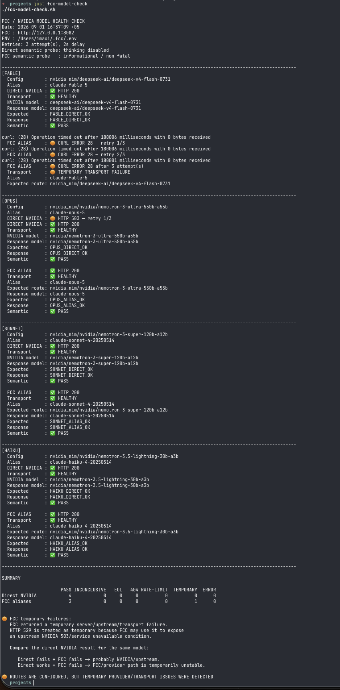

# fcc-model-check

`fcc-model-check` is a Bash health-check utility for validating model routing between **Free Claude Code (FCC)** and **NVIDIA NIM**.



It performs two complementary checks for each configured Claude-compatible model tier:

1. A **direct NVIDIA NIM request** to verify that the configured upstream model is available and responds correctly.
2. An **FCC alias request** through the local Anthropic-compatible `/v1/messages` endpoint to verify that FCC routing, alias resolution, and provider translation are working.

The script is designed for environments where FCC maps Claude-style aliases such as `claude-opus-5` or `claude-haiku-4-20250514` to NVIDIA NIM model identifiers defined in `~/.fcc/.env`.

---

## What it checks

The script validates four FCC model tiers:

| Tier | FCC alias |
|---|---|
| FABLE | `claude-fable-5` |
| OPUS | `claude-opus-5` |
| SONNET | `claude-sonnet-4-20250514` |
| HAIKU | `claude-haiku-4-20250514` |

For each tier it reads the corresponding model mapping from the FCC environment file:

```env
MODEL_FABLE=...
MODEL_OPUS=...
MODEL_SONNET=...
MODEL_HAIKU=...
```

An example FCC configuration might look like:

```env
MODEL_FABLE=nvidia_nim/deepseek-ai/deepseek-v4-flash-0731
MODEL_OPUS=nvidia_nim/nvidia/nemotron-3-ultra-550b-a55b
MODEL_SONNET=nvidia_nim/nvidia/nemotron-3-super-120b-a12b
MODEL_HAIKU=nvidia_nim/nvidia/nemotron-3.5-lightning-30b-a3b
```

The script does not modify any FCC configuration.

---

## Why two checks are necessary

A successful direct NVIDIA request does not necessarily prove that the same model works through FCC.

The two paths are different:

```text
Direct test

fcc-model-check
    |
    v
NVIDIA NIM API
    |
    v
Configured upstream model
```

and:

```text
FCC alias test

fcc-model-check
    |
    v
FCC /v1/messages
    |
    v
Claude-style alias
    |
    v
MODEL_* mapping
    |
    v
NVIDIA NIM
```

This distinction is useful when troubleshooting failures.

For example:

```text
Direct NVIDIA : PASS
FCC alias     : FAIL
```

usually indicates that the upstream model exists and is reachable, while the FCC routing/provider path is having a problem.

Conversely:

```text
Direct NVIDIA : FAIL
FCC alias     : FAIL
```

is stronger evidence of an NVIDIA-side or model-availability problem.

---

## Requirements

The script requires:

- Bash
- `curl`
- `jq`
- a running FCC server
- a valid NVIDIA NIM API key
- an FCC `.env` file containing model mappings

The default FCC environment file is:

```text
~/.fcc/.env
```

The default FCC endpoint is:

```text
http://127.0.0.1:8082
```

The default NVIDIA endpoint is:

```text
https://integrate.api.nvidia.com/v1/chat/completions
```

---

## Installation

Clone the repository:

```bash
git clone https://github.com/YOUR_USERNAME/fcc-model-check.git
cd fcc-model-check
```

Make the script executable if necessary:

```bash
chmod +x fcc-model-check.sh
```

Run it:

```bash
./fcc-model-check.sh
```

You can also place it somewhere on your `PATH`, for example:

```bash
mkdir -p ~/bin
cp fcc-model-check.sh ~/bin/fcc-model-check
chmod +x ~/bin/fcc-model-check
```

Then run:

```bash
fcc-model-check
```

---

## NVIDIA API key

The script first checks whether `NVIDIA_NIM_API_KEY` already exists in the current environment.

If it is not set, the script attempts to read it from the FCC environment file:

```env
NVIDIA_NIM_API_KEY=nvapi-...
```

The API key is never printed by the script.

You can override it for a single run:

```bash
NVIDIA_NIM_API_KEY="..." ./fcc-model-check.sh
```

For a public repository, never commit a real API key.

---

## Configuration

Most behavior can be changed with environment variables.

### FCC configuration

| Variable | Default | Description |
|---|---|---|
| `FCC_ENV` | `$HOME/.fcc/.env` | FCC environment file |
| `FCC_URL` | `http://127.0.0.1:8082` | FCC server URL |
| `FCC_TOKEN` | `freecc` | FCC proxy bearer token |

Example:

```bash
FCC_URL=http://127.0.0.1:9000 \
FCC_TOKEN=my-token \
./fcc-model-check.sh
```

### NVIDIA configuration

| Variable | Default |
|---|---|
| `NVIDIA_URL` | `https://integrate.api.nvidia.com/v1/chat/completions` |
| `NVIDIA_NIM_API_KEY` | read from the environment or FCC `.env` |

### Retry configuration

| Variable | Default | Description |
|---|---:|---|
| `RETRY_ATTEMPTS` | `3` | Maximum attempts for transient failures |
| `RETRY_DELAY` | `2` | Delay between attempts in seconds |

Example:

```bash
RETRY_ATTEMPTS=5 RETRY_DELAY=3 ./fcc-model-check.sh
```

### Token limits

| Variable | Default |
|---|---:|
| `DIRECT_MAX_TOKENS` | `64` |
| `FCC_MAX_TOKENS` | `256` |

The FCC probe uses a larger token budget because some reasoning models may emit thinking/reasoning text before their final answer.

### Timeouts

| Variable | Default |
|---|---:|
| `DIRECT_CONNECT_TIMEOUT` | `15` seconds |
| `DIRECT_MAX_TIME` | `180` seconds |
| `FCC_CONNECT_TIMEOUT` | `5` seconds |
| `FCC_MAX_TIME` | `180` seconds |

Example:

```bash
FCC_MAX_TIME=60 ./fcc-model-check.sh
```

---

## Direct NVIDIA probe

For each model, the script strips the FCC provider prefix:

```text
nvidia_nim/nvidia/nemotron-3-super-120b-a12b
```

becomes:

```text
nvidia/nemotron-3-super-120b-a12b
```

It then sends a direct OpenAI-compatible request to NVIDIA NIM.

The probe requests an exact validation token such as:

```text
SONNET_DIRECT_OK
```

The request includes:

```json
{
  "temperature": 0,
  "stream": false,
  "chat_template_kwargs": {
    "enable_thinking": false
  }
}
```

Disabling thinking makes the semantic probe more deterministic where supported.

If HTTP transport succeeds but the model does not return only the expected token, the test is classified as:

```text
SEMANTIC INCONCLUSIVE
```

This is not treated as a hard transport failure.

---

## FCC alias probe

The FCC check sends a request to:

```text
POST /v1/messages
```

with Anthropic-compatible headers:

```text
Authorization: Bearer <FCC_TOKEN>
Content-Type: application/json
anthropic-version: 2023-06-01
```

The model field contains the Claude-style alias rather than the upstream NVIDIA model identifier.

Example:

```json
{
  "model": "claude-opus-5",
  "max_tokens": 256,
  "messages": [
    {
      "role": "user",
      "content": "Reply exactly: OPUS_ALIAS_OK"
    }
  ]
}
```

A successful FCC response proves that the compatibility layer can:

- accept the Claude alias
- resolve the alias to the configured `MODEL_*`
- route the request to NVIDIA NIM
- translate the upstream response back into the Anthropic-compatible format

---

## Result classifications

Internally, each probe uses the following result categories:

| Internal code | Meaning |
|---:|---|
| `0` | PASS |
| `1` | UNAVAILABLE / HTTP 404 |
| `2` | RATE LIMIT / HTTP 429 |
| `3` | ERROR |
| `4` | SEMANTIC INCONCLUSIVE |
| `5` | EOL / HTTP 410 |
| `6` | TEMPORARY upstream or transport failure |

These internal result codes are used for aggregation. They are not the final process exit code.

---

## HTTP status handling

### HTTP 200

The route is reachable.

The script then performs a semantic check against the expected validation token.

### HTTP 404

Classified as unavailable.

Typical causes include:

- incorrect model ID
- model removed from the provider
- invalid FCC alias or route

A 404 is treated as a hard failure.

### HTTP 410

Classified as end-of-life.

This is especially useful with hosted model catalogs where models may be retired while old configurations still reference them.

A 410 is treated as a hard failure.

### HTTP 429

Classified as rate limiting.

The provider is considered reachable, but temporarily unable to serve the request because of quota or request-rate constraints.

This is not treated as a hard configuration failure.

### HTTP 500 / 502 / 503 / 504

These are classified as temporary upstream failures.

The script retries them according to `RETRY_ATTEMPTS` and `RETRY_DELAY`.

If all retries fail, the result remains `TEMPORARY`.

---

## FCC HTTP 529 handling

FCC may expose an upstream provider overload using HTTP `529`.

A common example is:

```text
HTTP 529

Category: service_unavailable
Mapped message: Provider is currently overloaded. Please retry.

Upstream error:
{"message":"Service temporarily overloaded","type":"service_unavailable","code":503}
```

Although `529` is not one of the normal NVIDIA upstream status codes, in this context it represents a temporary provider-side condition.

Therefore `fcc-model-check` explicitly treats:

```text
529
```

as a transient FCC error and retries it.

If retries are exhausted, it is counted under:

```text
TEMPORARY
```

rather than:

```text
ERROR
```

This prevents ordinary NVIDIA overload events from incorrectly producing a hard health-check failure.

---

## Error-body fallback detection

FCC/provider compatibility layers may occasionally return a non-standard HTTP status while the JSON body clearly describes a temporary upstream failure.

The script therefore also scans FCC error bodies for indicators including:

```text
service_unavailable
temporarily overloaded
provider is currently overloaded
please retry
upstream ... 503
code ... 503
```

If these patterns are detected, the failure is classified as temporary even if the HTTP status itself is unusual.

---

## curl transport error handling

Some `curl` failures represent temporary network conditions rather than configuration errors.

The script treats the following curl exit codes as transient:

| curl code | Meaning |
|---:|---|
| `7` | Failed to connect |
| `18` | Partial file |
| `28` | Operation timeout |
| `35` | TLS connection error |
| `52` | Empty reply from server |
| `55` | Send failure |
| `56` | Receive failure |

These errors are retried.

If every attempt fails, the result is reported as:

```text
TEMPORARY TRANSPORT FAILURE
```

rather than a hard error.

For example:

```text
curl: (28) Operation timed out after 180001 milliseconds

FCC ALIAS : 🟠 CURL ERROR 28 after 3 attempt(s)
Transport : 🟠 TEMPORARY TRANSPORT FAILURE
```

---

## Semantic checks

A transport-level HTTP 200 does not always mean that the model behaved exactly as expected.

The script asks each model to return a unique token such as:

```text
HAIKU_DIRECT_OK
```

or:

```text
HAIKU_ALIAS_OK
```

If the returned text matches exactly:

```text
Semantic : ✅ PASS
```

If the request succeeds but the response includes extra reasoning, thinking text, or other content:

```text
Semantic : 🟡 INCONCLUSIVE
```

This is intentionally non-fatal.

Reasoning models may expose internal or compatibility-layer reasoning content even when the underlying route is healthy.

---

## Summary table

After all tests, the script prints an aggregated table:

```text
SUMMARY

                     PASS INCONCLUSIVE   EOL   404 RATE-LIMIT  TEMPORARY  ERROR
Direct NVIDIA            4            0     0     0          0          0      0
FCC aliases              3            0     0     0          0          1      0
```

This makes it possible to distinguish between:

- model availability problems
- FCC routing problems
- transient provider failures
- rate limiting
- semantic irregularities

---

## Interpreting common scenarios

### Everything passes

```text
Direct NVIDIA  4 PASS
FCC aliases    4 PASS
```

Final status:

```text
✅ ALL MODELS, ROUTES AND SEMANTIC PROBES ARE HEALTHY
```

### Direct NVIDIA works, FCC fails temporarily

Example:

```text
Direct NVIDIA : ✅
FCC alias     : 🟠 timeout / 529 / service_unavailable
```

Likely interpretation:

- the NVIDIA model exists
- NVIDIA credentials are valid
- FCC/provider routing is temporarily unstable
- or the provider is overloaded during the FCC request

The script exits successfully because this is not considered a configuration failure.

### Direct NVIDIA and FCC both fail temporarily

This usually suggests:

- NVIDIA service degradation
- upstream overload
- provider connectivity problems

### Direct NVIDIA returns 404

Likely causes:

- incorrect model ID
- retired/unavailable model
- catalog mismatch

This is a hard failure.

### Direct NVIDIA returns 410

The model has reached end-of-life.

Update the corresponding `MODEL_*` entry in the FCC environment file.

### FCC returns 404 while direct NVIDIA passes

This strongly suggests an FCC alias/routing/configuration issue.

### HTTP 200 but semantic probe is inconclusive

The route is considered alive.

Some models produce reasoning text or ignore "reply exactly" instructions.

The condition is informational.

---

## Process exit codes

The script intentionally uses a simple final process status:

### Exit `0`

Returned when:

- all checks pass
- only temporary provider problems occur
- only rate limiting occurs
- only semantic checks are inconclusive
- or a combination of these non-hard conditions occurs

This makes the script suitable for operational diagnostics without failing CI merely because a provider was temporarily overloaded.

### Exit `1`

Returned when a hard failure is detected, including:

- model EOL / HTTP 410
- model unavailable / HTTP 404
- missing required model configuration
- unexpected non-transient direct API errors
- unexpected non-transient FCC errors
- missing prerequisites such as `curl`, `jq`, `.env`, or API key

---

## Example output

A healthy configuration with one temporary FCC timeout may look like:

```text
[FABLE]
  Config        : nvidia_nim/deepseek-ai/deepseek-v4-flash-0731
  Alias         : claude-fable-5
  DIRECT NVIDIA : ✅ HTTP 200
  Transport     : ✅ HEALTHY
  Semantic      : ✅ PASS

  FCC ALIAS     : 🟠 CURL ERROR 28 after 3 attempt(s)
  Transport     : 🟠 TEMPORARY TRANSPORT FAILURE

[OPUS]
  DIRECT NVIDIA : ✅ HTTP 200
  FCC ALIAS     : ✅ HTTP 200
  Semantic      : ✅ PASS

[SONNET]
  DIRECT NVIDIA : ✅ HTTP 200
  FCC ALIAS     : ✅ HTTP 200
  Semantic      : ✅ PASS

[HAIKU]
  DIRECT NVIDIA : ✅ HTTP 200
  FCC ALIAS     : ✅ HTTP 200
  Semantic      : ✅ PASS

SUMMARY

                     PASS INCONCLUSIVE   EOL   404 RATE-LIMIT  TEMPORARY  ERROR
Direct NVIDIA            4            0     0     0          0          0      0
FCC aliases              3            0     0     0          0          1      0

🟠 ROUTES ARE CONFIGURED, BUT TEMPORARY PROVIDER/TRANSPORT ISSUES WERE DETECTED
```

This is considered operationally healthy enough to return exit code `0`.

---

## Security notes

Do not commit:

```text
~/.fcc/.env
```

Do not commit your NVIDIA API key.

The repository should contain only the health-check script and documentation.

If you want to provide an example environment file, use placeholders only.

For example:

```env
NVIDIA_NIM_API_KEY=your-key-here
MODEL_FABLE=nvidia_nim/...
MODEL_OPUS=nvidia_nim/...
MODEL_SONNET=nvidia_nim/...
MODEL_HAIKU=nvidia_nim/...
```

---

## Suggested project structure

```text
fcc-model-check/
├── README.md
└── fcc-model-check.sh
```

---

## Intended use cases

`fcc-model-check` is useful for:

- validating FCC after upgrading Free Claude Code
- checking NVIDIA model availability
- detecting model EOL events
- troubleshooting Claude alias routing
- distinguishing FCC failures from NVIDIA failures
- validating new model mappings before using them in Claude Code or Codex
- periodic local health checks
- CI or monitoring jobs where transient upstream failures should not be treated as permanent configuration failures

---

## Notes

This utility is designed around FCC's Anthropic-compatible alias routing and NVIDIA NIM's OpenAI-compatible chat completions API.

Provider behavior can change over time. In particular:

- model IDs may be renamed or retired
- hosted models may reach EOL
- FCC may change how upstream errors are translated
- providers may introduce additional temporary HTTP status codes

If that happens, the transient/error classification tables in the script can be extended without changing the overall design.

---

## License

No license is included by default.

Before publishing the repository, add the license you want to use, for example MIT, Apache-2.0, or another license appropriate for your project.
